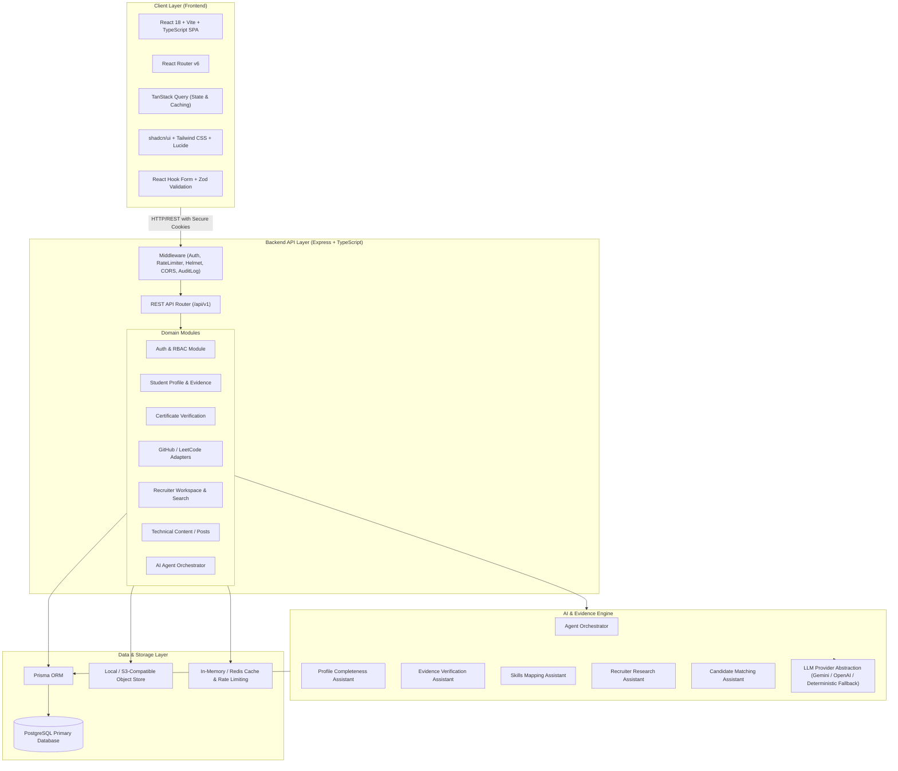
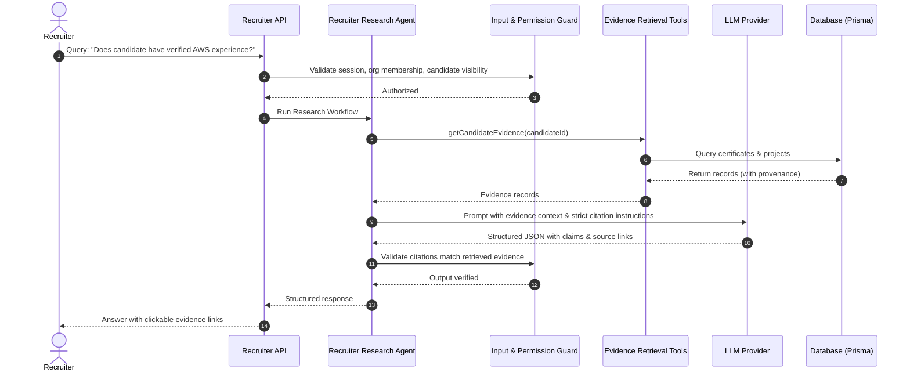

# Proofly — System Architecture & Design

## 1. High-Level Architectural Overview

Proofly is structured as a **modular monolith** with clean boundary segregation between domains, providing rapid developer velocity, high reliability, and low operational overhead.



---

## 2. Component Design & Responsibilities

### 2.1 Frontend Architecture (`packages/frontend`)
- **Vite + React 18 + TypeScript**: Lightning-fast HMR and type-safe JSX.
- **Routing & Guarding**:
  - `PublicRoute`: Accessible to all (landing, `/u/:username`, `/posts/:slug`, `/login`, `/register`).
  - `StudentRoute`: Requires authenticated user with role `STUDENT`.
  - `RecruiterRoute`: Requires authenticated user with role `RECRUITER` and verified organization membership.
- **State Management**:
  - Server state: TanStack Query with optimistic updates, smart invalidation, and configurable stale times.
  - Client state: React context for Auth session and theme.
- **UI & Accessibility**:
  - Tailwind CSS with semantic design tokens (neutral palette, accessible contrast ratios >= 4.5:1).
  - Component library built on accessible primitives (Radix UI / shadcn style) for Dialogs, Dropdowns, Tabs, Tooltips, and Modals.
  - Data visualizations: Recharts for GitHub commit distribution and skill proficiencies.

### 2.2 Backend Architecture (`packages/backend`)
- **Express + TypeScript**: Versioned REST API under `/api/v1`.
- **Security & Middlewares**:
  - `helmet`: Security headers (HSTS, CSP, X-Frame-Options, X-Content-Type-Options).
  - `cors`: Strictly whitelisted origins with `credentials: true`.
  - `cookie-parser`: Secure HTTP-only cookies for token storage.
  - `rateLimit`: IP and user-based throttling for auth endpoints and AI agent endpoints.
  - `validateRequest`: Zod middleware that intercepts requests before reaching controllers.
  - `errorHandler`: Centralized error handler returning structured JSON (`{ success: false, error: { code, message, details } }`).
  - `auditLogger`: Immutable logging of security-critical actions (role changes, org invites, credential verifications, profile visibility updates).

### 2.3 Shared Contract Layer (`packages/shared`)
- Single source of truth for TypeScript types, enums, DTOs, and Zod validation schemas.
- Ensures zero drift between frontend form validation and backend endpoint validation.

---

## 3. Database Architecture & Multi-Tenancy

- **Database Engine**: PostgreSQL with Prisma ORM.
- **Multi-Tenancy Model**:
  - Students: Scoped by `userId` and `studentProfileId`.
  - Recruiters: Scoped by `organizationId`. Recruiters can only access candidate notes, shortlists, and job postings belonging to their own organization.
- **Integrity & Indexing**:
  - Foreign keys with appropriate `ON DELETE CASCADE` or `RESTRICT` constraints.
  - Composite indexes on frequently queried fields (e.g. `[studentProfileId, name]`, `[organizationId, createdAt]`, `[status, visibility]`).
  - PostgreSQL full-text search indexes on candidate skills, project descriptions, and bio.

---

## 4. Integration Adapter Pattern

All third-party services adhere to an explicit interface:
```typescript
interface PlatformAdapter {
  platformName: string;
  fetchProfileStats(identifier: string): Promise<AdapterResult<PublicCodingStats>>;
  verifyProfileUrl(url: string): boolean;
}
```
- **Resilience**: Every adapter implements timeouts, exponential backoff, and circuit breaking.
- **Provenance**: Data returned from external platforms is wrapped in a provenance envelope containing `retrievedAt`, `sourceUrl`, `confidenceScore`, and `rawPayload`.
- **Graceful Failure**: If a platform changes its format or throttles requests, the adapter returns `{ success: false, error: "RATE_LIMITED", cached: true }` without crashing the application.

---

## 5. Agent Architecture & Safeguards



### Safety Principles:
1. **No Hallucinated Claims**: LLM cannot create evidence records. Only deterministic API responses can alter verification status.
2. **Strict Tool Scoping**: Agents only query data permitted by the user's role and organization boundary.
3. **Structured Validation**: All LLM outputs must parse against Zod schemas. If parsing fails, fallback to deterministic extraction.
4. **Prompt Injection Defense**: Untrusted text (candidate bios, project READMEs) is sanitized and enclosed in delimiter tags (`<untrusted_content>`) with explicit instructions to ignore embedded instructions.
5. **Deterministic Fallbacks**: Every agent capability operates even if LLM API keys are unset or external AI services are offline.
