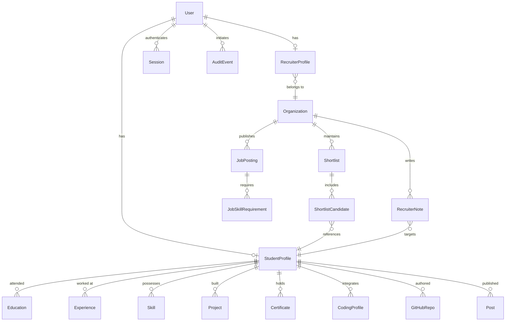

# Proofly — Data Model & Schema Specification

## 1. Entity Relationship Overview

The Proofly schema separates User authentication from role-specific profiles, isolates multi-tenant recruiter data, and maintains an immutable provenance trail for candidate claims.

---

## 2. Core Entities & Field Specifications

### 2.1 User & Authentication
- `id` (String, UUID/cuid, PK)
- `email` (String, unique, indexed)
- `passwordHash` (String)
- `role` (Enum: `STUDENT`, `RECRUITER`, `ADMIN`)
- `isEmailVerified` (Boolean, default false)
- `emailVerificationToken` (String, nullable)
- `passwordResetToken` (String, nullable)
- `passwordResetExpires` (DateTime, nullable)
- `createdAt` (DateTime, default now)
- `updatedAt` (DateTime, updated now)

### 2.2 StudentProfile
- `id` (String, PK)
- `userId` (String, unique, FK -> User.id)
- `username` (String, unique, indexed, used for `/u/:username`)
- `headline` (String, e.g. "Full-Stack Software Engineer & Distributed Systems Enthusiast")
- `bio` (String, Markdown supported)
- `avatarUrl` (String, nullable)
- `location` (String, nullable)
- `visibility` (Enum: `PUBLIC`, `RECRUITER_ONLY`, `PRIVATE`, default `PUBLIC`)
- `isOpenToWork` (Boolean, default true)
- `preferredRoles` (JSON / string array, e.g. `["Frontend", "Backend"]`)
- `targetGraduationYear` (Int, nullable)
- `completenessScore` (Int, default 0, computed by Profile Completeness Assistant)
- `createdAt`, `updatedAt`

### 2.3 Education & Experience
- **Education**:
  - `id`, `studentProfileId` (FK)
  - `institution` (String)
  - `degree` (String)
  - `fieldOfStudy` (String)
  - `startDate` (DateTime), `endDate` (DateTime, nullable)
  - `isCurrent` (Boolean)
  - `grade` / `gpa` (String, nullable)
  - `activities` (String, nullable)
- **Experience**:
  - `id`, `studentProfileId` (FK)
  - `company` (String)
  - `title` (String)
  - `location` (String, nullable)
  - `startDate`, `endDate`, `isCurrent`
  - `description` (String)

### 2.4 Skills & Verified Categories
- `id`, `studentProfileId` (FK)
- `name` (String, e.g. "TypeScript", "React", "PostgreSQL")
- `category` (Enum: `LANGUAGE`, `FRAMEWORK`, `DATABASE`, `TOOL`, `CLOUD_DEVOPS`, `CONCEPT`)
- `proficiencyLevel` (Enum: `BEGINNER`, `INTERMEDIATE`, `ADVANCED`, `EXPERT`)
- `yearsOfExperience` (Float, nullable)
- `isVerified` (Boolean, default false)
- `verifiedByCount` (Int, default 0 - number of verified projects/repos using this skill)

### 2.5 Projects & Project Evidence
- `id`, `studentProfileId` (FK)
- `title` (String)
- `tagline` (String)
- `description` (String, Markdown)
- `demoUrl` (String, nullable)
- `repositoryUrl` (String, nullable)
- `skills` (JSON / relation: string array of technologies used)
- `isFeatured` (Boolean, default false)
- `verificationStatus` (Enum: `UNVERIFIED`, `CODE_VERIFIED`, `DEMO_VERIFIED`, `ISSUER_VERIFIED`)
- `verificationNotes` (String, nullable)
- `evidenceMetadata` (JSON, contains commit counts, demo reachability check result, etc.)
- `createdAt`, `updatedAt`

### 2.6 Certificates & Credentials
- `id`, `studentProfileId` (FK)
- `title` (String, e.g. "AWS Certified Solutions Architect")
- `issuer` (String, e.g. "Amazon Web Services", "Coursera", "freeCodeCamp")
- `credentialId` (String, nullable)
- `credentialUrl` (String, nullable)
- `issueDate` (DateTime)
- `expiryDate` (DateTime, nullable)
- `doesNotExpire` (Boolean, default false)
- `verificationStatus` (Enum: `UNVERIFIED`, `ISSUER_VERIFIED`, `PENDING_REVIEW`, `FAILED_VERIFICATION`, `EXPIRED`)
- `verificationType` (Enum: `URL_CHECK`, `ISSUER_API`, `MANUAL_REVIEW`, `UNSUPPORTED`)
- `lastVerifiedAt` (DateTime, nullable)
- `verificationLog` (String, nullable)

### 2.7 External Coding Profiles (LeetCode, HackerRank)
- `id`, `studentProfileId` (FK)
- `platform` (Enum: `LEETCODE`, `HACKERRANK`, `CODEFORCES`)
- `username` (String)
- `profileUrl` (String)
- `totalSolved` (Int, default 0)
- `easySolved` (Int, default 0)
- `mediumSolved` (Int, default 0)
- `hardSolved` (Int, default 0)
- `ranking` (Int, nullable)
- `rating` (Float, nullable)
- `badges` (JSON, string array)
- `lastSyncedAt` (DateTime, nullable)
- `syncStatus` (Enum: `SYNCED`, `PENDING`, `FAILED`, `RATE_LIMITED`)
- `syncError` (String, nullable)

### 2.8 GitHub Repositories & Activity
- `id`, `studentProfileId` (FK)
- `githubRepoId` (String, unique per repo)
- `name` (String)
- `fullName` (String, e.g. "alex/proofly-web")
- `description` (String, nullable)
- `htmlUrl` (String)
- `primaryLanguage` (String, nullable)
- `languages` (JSON, language breakdown map)
- `starsCount` (Int, default 0)
- `forksCount` (Int, default 0)
- `isFork` (Boolean, default false)
- `isSelectedForProfile` (Boolean, default true)
- `lastCommitAt` (DateTime, nullable)
- `recentCommitCount` (Int, default 0)
- `lastSyncedAt` (DateTime, nullable)

### 2.9 Organization & Recruiter Profiles
- **Organization**:
  - `id`, `name`, `slug` (unique), `websiteUrl`, `logoUrl`, `verifiedAt`, `createdAt`
- **RecruiterProfile**:
  - `id`, `userId` (FK -> User.id), `organizationId` (FK -> Organization.id)
  - `fullName`, `title`, `department`, `createdAt`

### 2.10 Jobs, Shortlists & Notes
- **JobPosting**:
  - `id`, `organizationId` (FK), `title`, `description`, `location`, `employmentType`, `status` (`DRAFT`, `ACTIVE`, `CLOSED`)
  - `requiredSkills` (JSON), `preferredSkills` (JSON), `minGraduationYear` (Int, nullable)
- **Shortlist**:
  - `id`, `organizationId` (FK), `title`, `description`, `createdAt`
- **ShortlistCandidate**:
  - `id`, `shortlistId` (FK), `studentProfileId` (FK), `status` (`REVIEWING`, `INTERVIEW_SCHEDULED`, `ARCHIVED`), `addedAt`
- **RecruiterNote**:
  - `id`, `organizationId` (FK), `recruiterId` (FK), `studentProfileId` (FK), `content`, `tags` (JSON), `createdAt`

### 2.11 Technical Content (Posts & Case Studies)
- `id`, `studentProfileId` (FK), `title`, `slug` (unique), `summary`, `content` (Markdown)
- `tags` (JSON), `status` (`DRAFT`, `PUBLISHED`, `ARCHIVED`), `publishedAt`, `readTimeMinutes`

### 2.12 Audit & Verification Logs
- `id`, `actorId` (nullable FK to User), `organizationId` (nullable FK to Org), `action`, `resourceType`, `resourceId`, `payload` (JSON), `ipAddress`, `createdAt`
