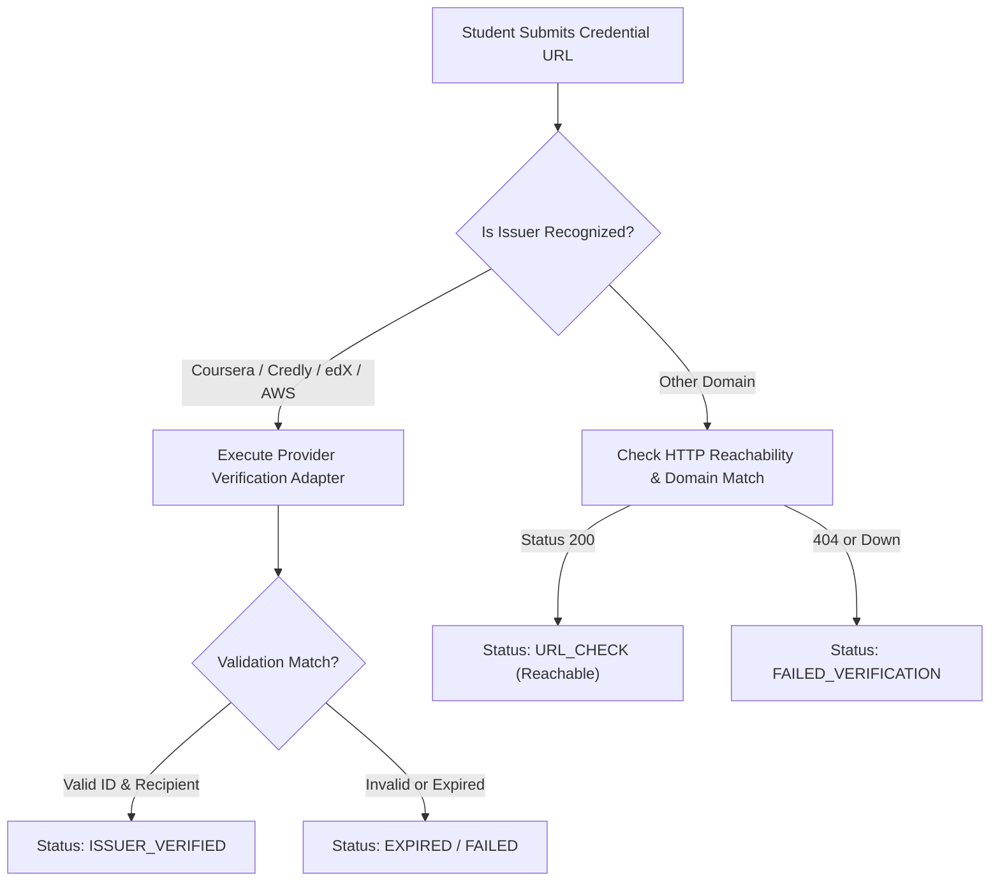

# Proofly — Integrations & Provider Adapters

## 1. Integration Strategy & Ethics

Proofly interfaces with external developer and credential platforms to capture high-fidelity signals.
Our principles:
1. **Authorized & Lawful**: Only access authorized APIs and permitted public endpoints. Never bypass authentication, use automated credential stuffing, or violate platform Terms of Service.
2. **Transparent Provenance**: Mark exactly where each metric originated, when it was retrieved, and the confidence level.
3. **No Fabrication**: If an API is inaccessible or fails, display an honest "Unable to verify" or "Sync Failed" state. Never substitute hardcoded vanity metrics.
4. **Rate Limit Courtesy**: Implement caching, backoff, and pagination controls to respect third-party resource limits.

---

## 2. GitHub Integration

### 2.1 Authentication & Scopes
- **Mode 1: GitHub OAuth App**: Standard Web application flow exchanging code for token. Requested scopes: `read:user`, `public_repo`.
- **Mode 2: Personal Access Token (PAT)**: For local testing and developer environments where public OAuth redirect URLs cannot be routed.
- **Storage**: Tokens are encrypted at rest using AES-256-GCM before storage in the database.

### 2.2 Data Ingestion & Caching
- **Repositories**: Fetches user's owned repositories. Filters out forks unless specifically pinned by the student.
- **Language Breakdown**: Queries repository languages to extract byte distributions.
- **Commit Recency**: Inspects latest commit timestamp to determine activity freshness.
- **Sync Cadence**:
  - Manual sync: Student can click "Sync GitHub" (debounced to once every 15 minutes).
  - Background sync: Nightly job updates repositories and commit metrics.
  - Rate limit tracking: Inspects `X-RateLimit-Remaining` headers. If remaining < 10, postpones sync and marks state as `RATE_LIMITED`.

---

## 3. LeetCode Provider Adapter

### 3.1 Supported Endpoints & Public Schema
- Queries LeetCode's public GraphQL endpoint (`https://leetcode.com/graphql`) with a read-only query for public profile metrics:
  - Total solved count, easy/medium/hard breakdown.
  - Public ranking and contest rating (if public).
  - Active badges.
- If LeetCode blocks the request (e.g. Cloudflare challenge or network restriction), the adapter gracefully records `SYNC_FAILED` with an explanatory error message, preserves the student's profile URL, and avoids crashing the profile.

---

## 4. HackerRank Provider Adapter

### 4.1 Supported Signals
- Inspects public REST profile (`https://www.hackerrank.com/rest/hackers/:username/profile`) and badges.
- Extracts language proficiency stars, contest scores, and badges.
- Same error-handling and fallback mechanics as LeetCode.

---

## 5. Certificate Verification Providers

### 5.1 Verification Workflow

### 5.2 Supported Verification Engines
- **Credly / Acclaim**: Regex ID parsing + public badge metadata verification.
- **Coursera**: Verify credential verify URL format (`coursera.org/verify/:id`).
- **freeCodeCamp**: Verify certification URL (`freecodecamp.org/certification/:username/:cert`).
- **Generic URL**: Performs an SSRF-safe HEAD/GET request to verify the certificate URL is alive and responds with HTTP 200.
